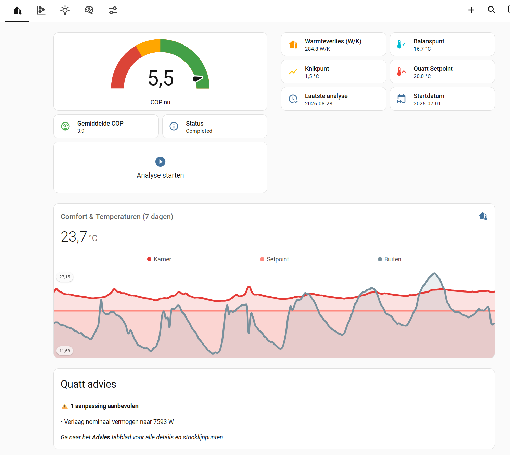
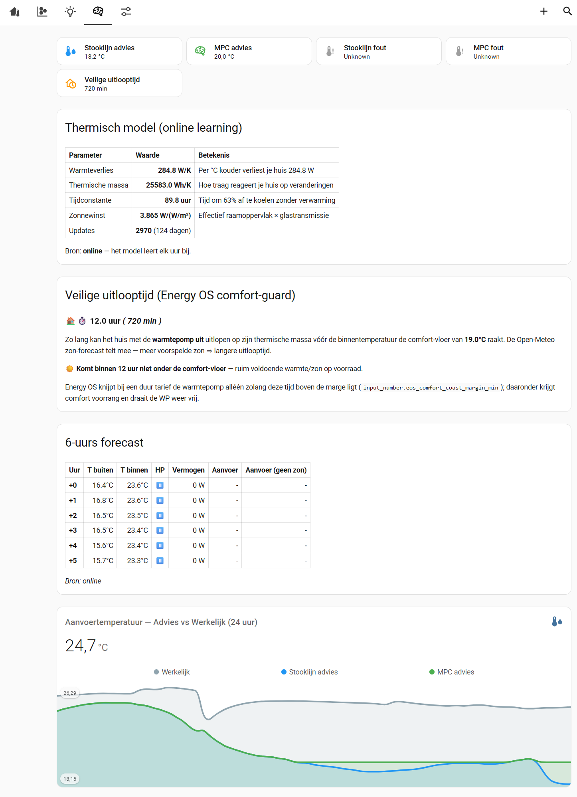

# Quatt Warmteanalyse

<p align="center">
  
</p>

Home Assistant custom integration for analyzing your Quatt heat pump performance. It measures
what your house actually needs — heat loss, balance point, the temperature where the gas
boiler has to assist — and turns that into concrete settings you can ask Quatt to change.
Optionally compares against your gas consumption from before the heat pump.

Everything it does is read-only by default: it advises, it does not steer your installation.
Two optional features do write to the heat pump, and both are off until you enable them:
[soundslider control](#soundslider-control) and
[max supply temperature](#max-supply-temperature). Which one fits your installation: see
[Choosing how to steer](#choosing-how-to-steer).



*The Overzicht tab: current COP, your home's measured heat loss and balance point, the knee
temperature where the boiler has to assist, and the concrete change to ask Quatt for.*

## What can you do with it?

Install it, let it run, and it answers these questions from your own data. The answers are on
the dashboard the integration creates for you.

| Question | Where to look | What you do with it |
|----------|---------------|---------------------|
| **What does my house need, and what should I ask to have changed?** | **Advies** tab | Pass the recommended heating limit (*stookgrens*) and rated power (*nominaal vermogen*) to your installer or Quatt support. The maximum water temperature you can change yourself in the Quatt app. See [Quatt advies sensor](#quatt-advies-sensor) |
| **Below which outdoor temperature does the boiler have to help?** | **Overzicht** tab | See where the heat pump no longer keeps up alone. This needs a cold period first |
| **Is my heating curve set too high?** | **Systeem** tab | Many compressor starts per hour while it is cold point at a curve that is too high. The **Advies** tab shows the measured curve. See [Short cycling](#short-cycling) |
| **Did the change I made actually help?** | **Rendement & besparing** tab | Enter the date of your change as the *Change marker date*. Later days are compared with your own installation at the same outdoor temperature. See [Judging a change](#judging-a-change) |
| **How long can the heat pump stay off before the house gets too cold?** | **Huismodel en vooruitblik** tab | Read the safe coast time, measured against the lowest indoor temperature you accept |
| **Would heating during cheap hours pay off?** | **Rendement & besparing** tab | Enter your tariff and read the predicted savings per day. It is a prediction and changes nothing. See [Price shift](#price-shift-shadow-measurement) |
| **How does this compare to my old gas boiler?** | **Analyse** tab | Optional: enter your gas meter and a period from before the heat pump |

### What you can act on depends on your controller

- **Quatt CiC:** you get advice to pass on. The heating limit and rated power are installation
  settings that only your installer or Quatt support can change. The CiC does not expose them, so
  the integration gives the recommended values without comparing them to what is set now.
- **OpenQuatt:** the integration reads your heating limit and tells you when it differs from the
  measurement. You set the recommended values yourself, and you can feed the measured heat demand
  directly into OpenQuatt's Power House. See [OpenQuatt readiness](#openquatt-readiness).

## First run — what to expect

The analysis starts automatically when Home Assistant starts, and again on demand. What it
can tell you depends entirely on how much data it has seen.

| When | What works |
|------|-----------|
| Immediately | Mirror sensors, data sources overview, live COP estimate |
| First run | Heat loss regression and balance point, using Home Assistant's long-term statistics — these often go back months, so results can be meaningful straight away |
| After ~2 days of heating | The online thermal model converges (48 hourly updates) and the look-ahead, coast time and stored heat start using it |
| 10 minutes after the first start, then daily | The emitter model is learned from the recorder (needs 48 heating hours in the last 60 days): heating curve points and the hours ahead in the look-ahead use it instead of a fixed return temperature |
| After weeks with the heat pump off now and then | The 2R2C house model can be approved for use. It needs at least 10 four-hour periods without heating, so an installation that starts in winter waits for spring or autumn |
| After the first cold period | Knee detection becomes reliable — it needs hours where the heat pump ran at full capacity below 10 °C |
| Over the following winters | Knee detection and the Quatt advice keep sharpening as the knee data store fills |

Two things are normal and not errors:

- **`unknown` on the error sensors while the pump is idle.** Comparing advice to actual
  supply temperature is meaningless without circulation, so they deliberately return
  nothing below 30 L/h.
- **An empty data sources table right after a restart.** Sources are re-evaluated once a
  minute; other integrations may still be starting.

The `analysis_status` sensor and the **Analyse** dashboard tab show what data is available.
If a result stays empty, that tab tells you which input is missing.

## Terminology

The analysis uses the Dutch terms your installer and Quatt support use, so you can repeat
them verbatim when you ask for a change. Dutch and English are used interchangeably below.

| Term | Meaning |
|------|---------|
| **Stooklijn** | Heating curve — the relation between outdoor temperature and the supply temperature the heat pump aims for. Flatter is usually more efficient. |
| **Aanvoertemperatuur** | Supply temperature — water leaving the heat pump towards your radiators or floor. |
| **Retourtemperatuur** | Return temperature — water coming back. |
| **Stookgrens** | Heating limit — the outdoor temperature above which no heating is needed. Called *balance point* in the English parts of this README. |
| **Knikpunt** | Knee temperature — the outdoor temperature below which the heat pump alone can no longer keep up and the gas boiler must assist. |
| **Nominaal vermogen** | Rated power — the heat output Quatt assumes your house needs at −10 °C. |
| **Warmtevraag** | Heat demand — how much power (W) your house currently needs. |
| **Warmteverlieslijn** | Heat-loss line — the straight line from your heating days: heat demand against outdoor temperature. Not the same as the *stooklijn*, which is about supply temperature. |
| **Huismodel** | House model — only the *learning* model (1R1C) that learns how fast your house warms up and cools down. |

## Requirements

- Home Assistant 2024.8.0 or newer (the options page uses form sections)
- At least one source for the measurements — either works, and they can be mixed:
  - [Quatt integration](https://github.com/marcoboers/home-assistant-quatt) (local polling of the CIC), and/or
  - [OpenQuatt](https://github.com/OpenQuatt/OpenQuatt) (ESPHome firmware reading the heat pump locally)
- A Quatt account is **not** required. The Quatt Insights cloud API only adds hourly detail and can be switched off entirely
- [apexcharts-card](https://github.com/RomRider/apexcharts-card) (HACS frontend) for the dashboard charts
- [mini-graph-card](https://github.com/kalkih/mini-graph-card) (HACS frontend) for the historical trend charts

## Installation

### HACS (recommended)

1. Open HACS in Home Assistant
2. Go to **Integrations** > **Custom repositories**
3. Add `https://github.com/Appesteijn/stooklijn` and select **Integration** as category
4. Search for "Quatt Warmteanalyse" and install
5. Restart Home Assistant

### Manual

1. Copy the `custom_components/quatt_stooklijn` folder to your Home Assistant `config/custom_components/` directory
2. Restart Home Assistant

## Configuration

1. Go to **Settings** > **Devices & Services** > **Add Integration**
2. Search for "Quatt Warmteanalyse"
3. Follow the setup wizard:

### Step 1: Heat pump data
- **Start/end date** — The period to analyze (after heat pump installation)
- **Outside temperature sensor(s)** — Entity picker; add several and the first available one is used, the rest fill gaps
- **Power sensor** — Entity for total heat pump power

Leave a field empty and auto-detection picks the entity at runtime. That is usually the better choice: entity IDs differ per Quatt installation (see the v2→v3 device migration), so a value that is right today can be wrong after an update.

### Step 2: Gas analysis (optional)
- **Gas entity** — Cumulative gas meter (m³)
- **Gas period** — Date range from *before* heat pump installation
- **Calorific value** — Gas energy content (default: 9.77 kWh/m³ for Dutch gas)
- **Boiler efficiency** — Your old boiler's efficiency (default: 0.90)
- **Hot water threshold** — Temperature above which gas usage is counted as hot water only (default: 18°C)

### Step 3: Soundslider control (optional)
- Enable the soundslider control switch and configure the highest day/night setting and the hours at which night starts and ends (the same night times as in the Quatt app)

### Change marker (optional)

**Change marker date** (`YYYY-MM-DD`, empty by default) tells the efficiency metric when you last
changed something. The norm freezes on everything before that date, and every heating day after it
is tested against it. Leave it empty and the boundary simply follows the last 30 heating days. See
[Judging a change](#judging-a-change).

### The options page (Configure)

**Configure** groups the settings in six sections, each field with a help text. A knob that is off starts collapsed; Measurements and Analysis start collapsed because auto-detection usually fills them. The settings are still stored as before, so nothing changes for an existing installation.

| Section | What is in it |
|---------|---------------|
| House and comfort | Fallback room setpoint, comfort floor, and (CiC only) the heating limit and rated power set in your Quatt |
| Max supply temperature | On/off, which model controls it, margin, target entity, minimum change, write interval. Not for OpenQuatt in Power House: there the setting is a safety limiter |
| Soundslider (CiC only) | On/off, which model controls it, highest day/night setting, night start/end (keep equal to the night times in the Quatt app) |
| Price shift (shadow measurement) | Tariff mode, price sensor or fixed prices and off-peak hours |
| Analysis | Start date, change marker, Quatt cloud, external limiter |
| Measurements | Every sensor role; leave empty for auto-detection |

The heat demand to OpenQuatt Power House is not on this page: you set it up in OpenQuatt (the source helper), see [below](#heat-demand-to-openquatt).

Some of these options in more detail:

- **Comfort floor** (default 19 °C) — The lowest indoor temperature you accept. It is the reference for coast time and stored heat, not the target temperature.
- **Fallback room setpoint** (default 20 °C) — Used only when the thermostat provides no setpoint.
- **Sun sensor: PV power** (empty by default) — The power of a PV installation (W or kW). It measures the sun locally: the house model learns from it, and the sun forecast is scored against it. The direction of the panels and of the windows is learned from the data, not asked. See [Solar gain correction](#solar-gain-correction).
- **External throttle entity** (empty by default) — For an external controller that caps the heat pump, such as a tariff-driven helper. Minutes where its value is below 20 are left out of the knee, stooklijn and heat-loss analysis, because a capped heat pump does not follow its natural curve.

## Data sources

The integration does not read sensors directly. It resolves twelve logical **roles** — supply temp, return temp, outside temp, room temp, control setpoint, room setpoint, flow rate, total power, power input, boiler heat, COP, compressor frequency — and each role is filled by the first candidate that actually delivers a number.

### Candidate order

```
your configured entity  →  Quatt integration  →  OpenQuatt  →  known fallback names
```

Quatt deliberately comes before OpenQuatt so existing installations keep exactly the same primary source after an update. A configured entity always wins, which is the only way to override that order.

If the active source stops delivering — `unavailable`, `unknown`, or a non-numeric state — the next candidate takes over automatically, and it switches back as soon as the preferred source recovers.

### Choosing sources yourself

Every one of the twelve roles has its own field in **Configure**. Leave it empty for auto-detection, or point it at any sensor you like — including one that belongs to neither integration. Set the outside temperature to your own weather station and the analysis will use it.

### Mirror sensors

Each role is also published as a `sensor.quatt_warmteanalyse_*` mirror with a fixed entity ID. Dashboards and automations should use these rather than the raw sensors: the mirror keeps one continuous history while the source underneath switches. Its attributes name the entity and integration currently delivering.

`sensor.quatt_warmteanalyse_databronnen` gives the full picture in one place: per role the active entity, its integration, all candidates, and when it last switched. The **Systeem** dashboard tab renders this as a table.

### Running without the Quatt cloud

The option **Use Quatt cloud API** (default on) controls whether the Quatt Insights service is queried at all.

Switched off, the integration keeps working:

- Daily analysis runs on Home Assistant's long-term statistics, which are never purged. It derives heat, electricity, boiler heat and COP itself.
- Knee detection keeps running on recorder minute data plus the knee data store.
- The insights cache is still **read**, so everything collected so far keeps contributing. Only new days stop being added.

What you give up is the hourly Quatt detail (a fallback for knee detection and a backfill source for historical cold spells) and the current day, which the API used to supply live before Home Assistant has closed the day's statistics.

Worth knowing: this switch does not affect the Quatt HA integration, which polls your CIC locally. If OpenQuatt is your only other source, consider that turning the cloud off leaves each role with a single candidate and no fallback.

## Usage

The analysis runs **automatically** when Home Assistant starts, so your dashboards are always populated after a restart.

You can also trigger an analysis manually:

1. Call the `quatt_stooklijn.run_analysis` service, or
2. Press the **Analyse Starten** button on the dashboard

### Dashboard

The integration creates the **Quatt Warmteanalyse** dashboard itself on first setup — you do
not have to import anything. A copy also lives in `dashboards/quatt_stooklijn_dashboard.yaml`
if you would rather build your own from it.

If the dashboard does not appear, a repair notice tells you so. You can then create it yourself:
**Settings → Dashboards → Add dashboard → New dashboard from scratch**, with URL
`quatt-warmteanalyse`. Leave it empty; on the next restart (or a reload of the integration) it is
filled and kept up to date like any other. Up to v0.10.5-beta.3 the integration could not create
the dashboard on Home Assistant 2025.2 or later at all, and failed silently.

If you delete the dashboard, it stays deleted: the integration remembers that it wrote it once
and does not bring it back on the next restart. Removing the whole integration clears that
memory, so a fresh installation creates the dashboard again. To get it back without
reinstalling, call the `quatt_stooklijn.update_dashboard` service. That is also the way out if
you removed and reinstalled the integration before v0.10.5-beta.5 and no dashboard appears.

Later releases keep it up to date, but only when that is safe:

- If the dashboard is still exactly as the integration last wrote it, a new version is applied
  silently.
- If you changed it — added a card, edited a chart — it is left alone, and a repair notice
  offers you the new version instead. Ignoring the notice keeps your own dashboard.

To take the shipped version regardless (and lose your changes to that dashboard), call the
`quatt_stooklijn.update_dashboard` service.

The dashboard has six tabs:

| Tab | Contents |
|-----|----------|
| **Overzicht** | Key metrics (COP, heat loss, balance temp, knee), comfort chart, quick advice |
| **Analyse** | Heat loss scatter + trendlines, COP vs temperature, heat demand table, data availability |
| **Advies** | Quatt parameter recommendations, stooklijn breakpoints, OpenQuatt integration |
| **Huismodel en vooruitblik** | The learning house model, 12-hour forecast, the three advices against actual supply temperature, deviation sensors, model comparison (called MPC before v0.10.7-beta.9) |
| **Rendement & besparing** | Efficiency against your own norm, whether a change helped, price shift (when a tariff is configured) |
| **Systeem** | Which knob fits your installation, data sources per measurement, max supply temperature, compressor starts, 48-hour aligned charts: power, starts vs outdoor temp, advice deviation, flow & outdoor temp; soundslider control when enabled; steering effect |

### Adapting the dashboard to your setup

Nothing needs adapting. The dashboard references only `sensor.quatt_warmteanalyse_*`
entities, which this integration creates itself with fixed entity IDs. Those keep working no
matter which integration delivers the underlying measurement, and no matter how your Quatt
sensors happen to be named — the max supply temperature is read through an attribute on the
integration's own sensor rather than through a Quatt entity ID, so the pre/post device-migration
naming difference does not matter.

Cards for optional features hide themselves when the feature is off, so an unused card does
not show errors — it simply is not there.

**Weather forecast — needed for the 12-hour look-ahead:**

The look-ahead on the *Huismodel en vooruitblik* tab needs a weather forecast entity for the outdoor temperature of the next 12 hours. Solar radiation comes separately from [Open-Meteo](https://open-meteo.com/). During setup you are asked to provide a weather entity; the default is `weather.home`.

Almost every Home Assistant installation has this: the built-in [Met.no integration](https://www.home-assistant.io/integrations/met/) creates `weather.home` automatically. If your entity is named differently (e.g. `weather.your_city`), update it in **Settings > Devices & Services > Quatt Warmteanalyse > Configure**.

> **No weather integration?** The advice keeps working, because it only uses current conditions. The look-ahead then assumes the current outdoor temperature for every hour, and the [price shift](#price-shift-shadow-measurement) has no result. Install Met.no (free, no API key) or any other HA weather integration to get a real forecast.

## Feature overview

- **Heating curve analysis** — Calculates the optimal stooklijn based on actual heat pump data and compares it with Quatt's estimated curve
- **Heat loss coefficient** — Determines your home's heat loss in W/K using linear regression
- **COP tracking** — Average coefficient of performance and per-temperature scatter data
- **Knee temperature** — Detects the outdoor temperature where supplemental heating (boiler) kicks in
- **Gas comparison** (optional) — Compare heat pump performance with historical gas consumption from before installation
- **Supply advice and look-ahead** — Calculates a recommended supply temperature in three variants (*Outdoor temperature*, *Outdoor temperature + room*, *House model + room*), plus a 12-hour look-ahead with the learned house model and the weather forecast. The sensors write nothing themselves; see [Choosing how to steer](#choosing-how-to-steer)
- **Online thermisch model** — Learns how fast your house warms up and cools down (thermal mass Wh/K, solar gain) every hour, with heat loss and constant heat gain held at the heat-loss regression. It feeds the look-ahead, coast time, stored heat and price shift; see [Which model is used where](#which-model-is-used-where)
- **Model comparison** — Scores a two-node (2R2C) house model against the running model on held-out data, once a day. Once it is approved for use (it also has to predict cooling with the heat pump off), it feeds the drift limit of the price shift, the room lines and the coast time; it never steers a knob. See [2R2C model](#2r2c-model)
- **Emitter model** — Learns from the recorder how much water temperature your radiators or floor need for a given heat output, `P = k · (T_water − T_room)^n`. Used for the heating curve points, the hours ahead in the look-ahead and the advice while the pump is stopped. See [Emitter model](#emitter-model)
- **Quatt advies** — Shows exactly which parameters to ask Quatt to adjust (stookgrens, nominaal vermogen, stooklijn breakpoints)
- **Soundslider control** (optional, CiC only) — Limits the power through the soundslider of the Quatt (day and night maximum sound level) until the supply matches the chosen advice, with separate day/night limits
- **Max supply temperature** (optional) — Writes the chosen advice plus a margin to the controller's maximum supply temperature setting
- **OpenQuatt ready** — Output sensors with optimal heating curve breakpoints and balance point, ready for OpenQuatt automations
- **Heat demand to OpenQuatt** — Publishes the measured house heat demand (W) for OpenQuatt's external heat demand input (Power House)
- **Source abstraction** — Every measurement is exposed through a mirror sensor with a stable entity ID. Dashboards and automations keep working while the underlying source (Quatt, OpenQuatt, or your own sensor) switches or drops out
- **Runs without the cloud** — The Quatt Insights API is optional. With it off, the analysis continues on Home Assistant's own long-term statistics plus the integration's stored history
- **Kortcyclen zichtbaar** — Counts compressor starts per hour and plots them against outdoor temperature; many starts while it is cold is the signature of a heating curve set too high
- **Dashboard included** — Pre-built Lovelace dashboard with six tabs, including a Systeem view showing which integration delivers each measurement

## Sensors

Entity IDs are `sensor.quatt_warmteanalyse_<name>`, with the names below.

| Sensor | Unit | Description |
|--------|------|-------------|
| `heat_loss_coefficient` | W/K | Heat loss per degree below balance point |
| `balance_point_temperature` | °C | Outdoor temp where no heating is needed |
| `optimal_stooklijn_slope` | W/°C | Slope of the optimal heating curve |
| `quatt_warmteanalyse_slope` | W/°C | Slope of Quatt's estimated curve |
| `knee_temperature` | °C | Temperature where boiler must assist |
| `average_cop` | — | Average coefficient of performance |
| `freezing_performance_slope` | W/°C | Heat pump performance below 0°C |
| `gas_heat_loss_coefficient` | W/K | Heat loss from gas period (if configured) |
| `last_analysis` | timestamp | When the last analysis was run |
| `analysis_status` | — | Current analysis status |
| `data_statistieken` | — | Data availability per source (recorder days, cache days, knee store points) |
| `quatt_advies_parameters` | — | Recommended Quatt parameter changes with full detail attributes |
| `openquatt_balance_point` | °C | Optimal balance point for OpenQuatt |
| `openquatt_stooklijn` | — | 6 heating curve breakpoints for OpenQuatt |
| `openquatt_power_house_kalibratie` | — | Advised Power House parameters (cold temp, rated power, zero-power temp) |
| `warmtevraag` | W | House heat demand, feeds OpenQuatt's Power House feedforward |
| `databronnen` | — | Which integration delivers which measurement, with candidates and switch times |
| `modelvergelijking` | — | Result of the daily 2R2C comparison, with `goedgekeurd_voor_gebruik` (approved for use) and the replay — see [2R2C model](#2r2c-model) |

**Mirror sensors** (one per role, stable entity ID regardless of which integration delivers — use these in dashboards and automations):

| Sensor | Unit | Sensor | Unit |
|--------|------|--------|------|
| `aanvoertemperatuur` | °C | `thermisch_vermogen` | W |
| `retourtemperatuur` | °C | `opgenomen_vermogen` | W |
| `buitentemperatuur` | °C | `ketelvermogen` | W |
| `kamertemperatuur` | °C | `debiet` | L/h |
| `thermostaat_setpoint` | °C | `cop` | — |
| `kamer_setpoint` | °C | `compressorfrequentie` | Hz |

Each carries `source_entity`, `source_integration`, `candidates` and `switched_at` as attributes.

**Live sensors** (update in real-time based on current conditions):

| Sensor | Unit | Description |
|--------|------|-------------|
| `geschatte_actuele_cop` | — | Interpolated COP at current outdoor temperature |
| `aanbevolen_aanvoertemperatuur` | °C | Advice *Outdoor temperature* (source `stooklijn`): the heat-loss line, outdoor temperature only. With the pump stopped the supply comes from the emitter model (`aanvoer_uit`) |
| `mpc_aanbevolen_aanvoertemperatuur` | °C | Advice *Outdoor temperature + room* (source `mpc`): the heat-loss line plus catch-up for a room below setpoint |
| `1r1c_aanbevolen_aanvoertemperatuur` | °C | Advice *House model + room* (source `1r1c`): the learning house model (1R1C) with the same catch-up; passes *Outdoor temperature + room* through (`terugval: true`) until the model is online |
| `stooklijn_fout_aanvoertemperatuur` | °C | Deviation: advice *Outdoor temperature* − actual supply |
| `mpc_fout_aanvoertemperatuur` | °C | Deviation: advice *Outdoor temperature + room* − actual supply |
| `veilige_uitlooptijd` | min | How long the house can coast with the heat pump off before hitting the comfort floor. With an approved 2R2C both house models compute it and the shorter one wins (`model_source`, both in `per_model`). Attribute `recovery_on_min_minutes` is how long getting back to the room setpoint takes with the heat pump at its minimum output |
| `opgeslagen_warmte` | kWh | Heat stored in the building above the comfort floor: what the house has to lose before it reaches that floor. Negative when the room is below it. Available once the online model has converged |
| `max_aanvoertemperatuur_instelling` | °C | Value last written to the heat pump's max supply temperature (only when [max supply temperature](#max-supply-temperature) is enabled) |
| `geluidsniveau` | — | Current soundslider setting (`building87` / `silent` / `library` / `normal`) — only when soundslider control is enabled |
| `compressorstarts` | starts/uur | Compressor starts in the last hour — see [Short cycling](#short-cycling) |
| `cop_prestatie` | — | Efficiency against this installation's own norm at the same outdoor temperature and the same half of the season — see [Judging a change](#judging-a-change) |
| `zonverwachting` | W/m² | Mean error of the Open-Meteo sun forecast three hours ahead; attribute `per_vooruitkijktijd` has the error per lead time (1, 2, 3, 6, 12 h), next to "keep the current clearness" when a sun sensor is set — see [Solar gain correction](#solar-gain-correction) |
| `prijsverschuiving` | EUR | Predicted savings, summed per day, had heat demand been shifted to cheaper hours — only when a tariff is configured, see [Price shift](#price-shift-shadow-measurement) |
| `plan_nu` | W | The heat output of the current quarter hour in the shifted price plan, next to the flat output, the matching setpoint shift and (with the emitter model) supply temperature. Shadow only: it controls nothing |

Both error sensors return no value while the pump is idle (flow below 30 L/h): comparing advice against actual supply temperature is meaningless without circulation. When the supply sensor check reports an offset (an uncalibrated sensor reading higher than the heat pump's own outlet), that offset is subtracted here (`aanvoer_correctie_k`), so a measuring error does not show up as an advice error. Nothing that steers or learns is corrected: your controller measures with that same sensor.

**Binary sensors:**

| Entity | Description |
|--------|-------------|
| `gasketel_actief` | Whether the gas boiler is currently producing heat |

**Control entities** (only when soundslider control is enabled):

| Entity | Type | Description |
|--------|------|-------------|
| `geluidsniveau_compensatie` | switch | Soundslider control on/off (the entity ID keeps its old name) |

**Other entities:**

| Entity | Type | Description |
|--------|------|-------------|
| `analyse_startdatum` | text | Start date of the analysis period, editable from the dashboard |

## Services

| Service | Description |
|---------|-------------|
| `quatt_stooklijn.run_analysis` | Run the full analysis pipeline |
| `quatt_stooklijn.clear_data` | Clear all analysis results and reset sensors |
| `quatt_stooklijn.update_dashboard` | Overwrite the dashboard with the shipped version, or create it again if you deleted it. Your changes to that dashboard are lost |

## Supply advice and look-ahead

Three advice sensors calculate what supply temperature your heat pump *should* be running at, each with a different input: **Outdoor temperature** (`stooklijn`), **Outdoor temperature + room** (`mpc`) and **House model + room** (`1r1c`). The second also looks 12 hours ahead. The sensors themselves write nothing; the [max supply temperature](#max-supply-temperature) and the [soundslider control](#soundslider-control) follow one of them when you choose it as their source.

The source called `mpc` is not model predictive control. The name is historical, and until v0.10.7-beta.9 it was shown as "MPC"; the internal value stays so existing settings keep working. Below, "the advice" is the *Outdoor temperature + room* advice.

### How it works

The sensor produces two things, from different inputs.

**The advice** (the sensor's value) uses current conditions only:

1. Reads the current outdoor, room and return temperature, the flow and the room setpoint
2. Takes the heat loss of the house at the current outdoor temperature from the heat-loss regression: `U × (balance point − outdoor)`. The balance point is fitted on daily averages, so the average solar gain is already in it
3. Adds a catch-up term for a room below its setpoint: `10 × U × (setpoint − room)`. A room above its setpoint lowers the advice the same way. Above the balance point there is no catch-up demand
4. Limits that power to what the heat pump can deliver at this outdoor temperature, and converts it to a supply temperature, limited to 20–55 °C. With the pump running that uses the measured return and flow; with the pump stopped the return is cooled-down water, so the [emitter model](#emitter-model) is used instead. No demand means no value

The catch-up term is proportional to the heat loss on purpose. Until v0.10.6 the advice tried to make up a shortfall within one hour, which scales with the thermal mass of the house: on a heavy floor a few tenths of a degree pushed the advice up by several degrees. With `10 × U`, a shortfall of 0.3 °C asks for 3 × U extra: about 850 W for a house that loses 285 W/K.

**The look-ahead** (the 12-hour table on the *Huismodel en vooruitblik* tab) simulates the house forward with the outdoor temperature forecast from your weather entity and the radiation forecast from Open-Meteo. Hour +0 converts power to supply temperature with the measured return; the hours after that with the emitter model, because the return of now says little about the return in six hours.

Until the house model has learned enough (`model_source: batch_fallback`), there is no room to simulate. The table then shows the advice for each hour at the forecast outdoor temperature, with the catch-up term only in hour +0: how fast the room catches up depends on the thermal mass, which is exactly what is not known yet. From +1 on, a shortfall is therefore underestimated. The room and buffer columns stay empty, and the attribute `vooruitblik_basis` says which of the two the table uses (`huismodel` or `zonder_huismodel`).

Despite the name, the advice is not an optimisation over the forecast horizon: the forecast does not change the sensor's value.

The result is compared to the actual supply temperature via the **deviation sensors** on the same tab:
- A positive error means the sensor advises a higher supply temperature than what's currently running (risk of underheating)
- A negative error means the sensor advises lower (heat pump is running warmer than necessary)



*The Huismodel en vooruitblik tab (called MPC before v0.10.7-beta.9): the learned thermal model of your house, how long it can coast with the heat
pump off, the 12-hour forecast, and advice versus actual supply temperature.*

### Solar gain correction

The integration uses [Open-Meteo](https://open-meteo.com/) shortwave radiation (W/m²) as its solar input. The online model learns how much of that radiation ends up as heat inside your home; this calibration improves over time.

Open-Meteo reports radiation as the mean over the *preceding* hour. Up to v0.10.6-beta.11 the integration read that as the current hour, so the sun arrived an hour late in every model. That is fixed.

Horizontal radiation with one fixed factor does not fit all seasons: a low winter sun shines almost straight through vertical glass, a high spring sun hardly. With a **sun sensor** (PV power) the integration also works out how much sun comes through the windows, and the model comparison fits the two-state model on that as well. On the measured house that predicted the room 14–20 % better twelve hours ahead. It only compares; nothing is controlled with it yet.

Nothing about orientation needs to be entered. The direction of the panels is learned once a day from a year of PV statistics: at the right direction, the clear-sky output has the same shape over the whole day. The direction of the windows is learned roughly (east, south-east, south, south-west, west) in the nightly model comparison; finer is not possible, and not needed — on the measured house everything between 135° and 250° predicted equally well. The tilt of the panels is fixed at 30°; 15–35° made no difference.

The house models learn their solar factor on what Open-Meteo reports for the current hour, and that differs from what it forecast for the same hour a few hours earlier. The look-ahead therefore scales the hours ahead to the scale of the current hour (`zon_vooruitblik_factor`, from 60 daylight hours on, limited to 0.7–1.3). It deliberately does not use the measured/forecast factor of the sun forecast sensor: that would lower the sun twice.

The `zonverwachting` sensor records, at every fetch, what Open-Meteo expects for the next twelve hours, and later scores that against what came: measured with the sun sensor, or without one against the last forecast for the same hour. That is the groundwork for control that takes the sun of the coming hours into account.

### The sensors write nothing

The advice sensors only produce advice. A knob writes to the heat pump only when you switch it on and choose that advice as its source; see [Choosing how to steer](#choosing-how-to-steer).

### Price shift (shadow measurement)

Would it pay to heat when electricity is cheap? Set **Price shift** in the options to
`normaal_dal` (fixed contract with normal and off-peak tariff, off-peak hours and weekend
configurable) or `dynamisch` (a price sensor that carries today's and tomorrow's hourly prices as
attributes — Nord Pool, ENTSO-e, EnergyZero and similar; quarter-hour prices are averaged per
hour). The `prijsverschuiving` sensor then appears.

Every night at 00:05 it takes the coming 24 hours: the heat the house model needs to hold the room setpoint,
redistributed to the hours with the most heat per euro. The plan bends away from the flat path:
`P + γ · P̄ · (1 − r)`, where `r` is the cost of a kWh of heat in that hour (price / COP) relative
to the average. γ = 0 is the flat path itself and the deviation grows linearly with γ. The total
heat stays exactly the same. Once the heat pump's minimum output has been learned (see below),
every hour of the plan is either off or at least that minimum: below it the heat pump delivers in
on/off blocks, and the plan does the same. γ is chosen per day by the same scan as before — the calmest value
that captures nearly all of the gain without exceeding the firmware ceiling. The room may drift at
most 0.3 K below and 0.5 K above the flat path; that drift is computed with the approved 2R2C when
there is one, otherwise with the 1R1C (attribute `driftmodel`). The extra heat loss from preheating
(`UA · drift` per warmer hour) is charged against the savings. A colder house does not count as a
gain. The day's predicted savings go into the total. Days without heat demand are skipped. Without
a weather forecast for at least three quarters of the window there is no result (the reason is
shown), and the nightly run retries up to four times at 15-minute intervals before skipping the
day.

**Supply temperature costs COP.** Packing heat into fewer hours needs a higher supply temperature.
With the [emitter model](#emitter-model) the shifted plan gets a COP corrected by the ratio of two
Carnot values against the flat path (`cop_met_aanvoer`). Both powers are clamped at the minimum
output first: below it the heat pump runs on/off at that minimum anyway. The COP at supply
temperature cannot be learned from the measurements themselves, because the supply follows the
heating curve and so moves along with the outdoor temperature.

Each stored day carries its calculation method. Days from an earlier method do not count in the
total; since v0.10.7-beta.9 (2R2C drift limit and supply COP) the total therefore started again.
Within one method the attribute `per_model` splits the total by drift model and supply COP.

Alongside it, a pure COP shift (towards the hours with the best COP) is priced at the same tariffs
(`besparing_alleen_cop_eur`). The difference between the two is what the price adds. The
attribute `komend_etmaal` shows the plan for the next 24 hours per quarter hour and refreshes every
hour. The `plan_nu` sensor reads the current quarter hour from it.

**Minimum output.** A heat pump does not modulate down to zero. The integration learns its lowest
continuous heat output per outdoor temperature from its own 5-minute log, using only samples in the
middle of a run (attribute `minimumvermogen` on `mpc_aanbevolen_aanvoertemperatuur`). Until enough stable runs are
logged nothing uses it. The forecast table shows per hour which share of the hour the heat pump
runs (`aan_pct`), and the coast-time sensor shows the recovery time at minimum output.

It is a model prediction, not a metered result, and **it controls nothing**. Solar gain, room
temperature, setpoint and thermal mass are part of it. Actually shifting heat would
have to go through the room setpoint; the firmware's comfort term cancels a higher power demand
as soon as the room is above setpoint.

## Quatt advies sensor

The `sensor.quatt_warmteanalyse_quatt_advies_parameters` sensor analyzes your heat pump data and tells you what to change. For a Quatt CiC the stookgrens and rated power are installation settings: they are not in the Quatt app, but your installer or Quatt support can check and change them, so you need to tell them what to ask for. The maximum water temperature is the one setting you can change yourself in the app.

The integration can only compare against a setting it knows. A Quatt CiC does not expose its stookgrens or rated power to Home Assistant, so by default the sensor gives the recommended values only. If you know what is set (ask your installer or Quatt support), enter it under **Settings → Integrations → Quatt Stooklijn → Configure** (*Stookgrens zoals ingesteld in je Quatt* and *Nominaal vermogen bij -10 °C zoals ingesteld*). The advice then becomes "raise/lower from X to Y", and the dashboard marks the value as *handmatig ingevuld*: it is what you typed, so update it when your installer changes something. Leave a field empty to go back to "unknown". With OpenQuatt the stookgrens (`Maximum heating outdoor temperature`) is read, and a difference counts as an adjustment. It uses the same rule as the [Power House calibration](#heat-demand-to-openquatt), so the two never disagree.

The sensor state is one of:

- `N aanpassing(en) aanbevolen` — a known setting differs from the recommendation: the stookgrens (read from OpenQuatt or entered for a CiC), the rated power (entered for a CiC), or a maximum water temperature below what the house needs at -10°C
- `Geen afwijking gevonden` — the stookgrens was read and is fine (OpenQuatt), or both CiC values were entered and are fine
- `Aanbevolen instellingen beschikbaar` — not enough is known; the attributes hold the recommended values

| Attribute | Description |
|-----------|-------------|
| `stookgrens_huidig` | Stookgrens as set (°C): read from OpenQuatt, or entered in the options for a CiC; otherwise `null` |
| `stookgrens_optimaal` | Recommended stookgrens: the measured balance point of your home |
| `stookgrens_bron` | `openquatt` (read), `handmatig` (entered in the options, CiC only) or `onbekend` |
| `stookgrens_advies` | Human-readable advice text |
| `nominaal_vermogen_huidig_w` | Rated power as entered in the options (CiC only); `null` when not entered. No controller exposes it |
| `nominaal_vermogen_optimaal_w` | Recommended rated power at -10°C, from the measured heat loss |
| `nominaal_vermogen_bron` | `openquatt` (see the Power House calibration instead), `handmatig` (entered) or `onbekend` |
| `nominaal_vermogen_advies` | Human-readable advice text |
| `max_water_huidig` | Maximum water temperature as currently set (°C), or `null` if it cannot be read |
| `max_water_nodig_bij_min10` | Supply temperature the house needs at -10°C, from the measured heat loss. With the emitter model the higher of the emitter model and the fixed 28 °C return: at -10 °C the emitter model is extrapolated beyond what it has seen |
| `max_water_automatisch` | `true` when this integration adjusts the maximum water temperature itself |
| `max_water_advies` | Human-readable advice text. A minimum only: it never advises lowering the setting |
| `stooklijn_punten` | 6 optimal heating curve breakpoints (-10°C to +15°C), for reference. `stooklijn_punten_bron` says whether they come from the emitter model (at the room temperature it was learned at) or a fixed 28 °C return and 800 L/h |
| `stooklijn_advies` | Only with OpenQuatt (Heating Curve mode): the points for its six `Curve Tsupply` numbers (-20°C to +15°C). `null` for a Quatt CiC, which does not run on a heating curve |
| `aantal_aanpassingen` | Number of verified differences |

> **Why no "current" value for Quatt?** Up to v0.10.4 the current stookgrens and rated power were estimated from a regression on daily averages. That fit only covers a narrow band of cold days and had to be extrapolated far to reach its zero point, and daily heat mostly reflects what the house asks for (the room thermostat corrects), not how the heating curve is set. One user got "raise from 13 to 16" while Quatt confirmed the setting was already 16. Since v0.10.6 you can enter the real values yourself instead; they are never guessed. The rated power counts as off when it differs by 250 W or more, the same threshold the Power House calibration uses.

## Choosing how to steer

Three knobs can act on the heat pump. This says which one fits your controller and which source to start with. Which source steers most efficiently on *your* house it cannot say: that has been measured on one house so far. For that, use the [steering effect](#steering-effect).

**Step 1: which knob fits which controller**

| Controller | Max supply temperature | Soundslider control | Heat demand to OpenQuatt |
|---|---|---|---|
| Quatt CiC | Yes | Yes | No |
| OpenQuatt outside Power House | Yes | No, CiC only | No |
| OpenQuatt in Power House | No: there it is a safety limiter (derate within 3 K, trip at +5 K) | No, CiC only | Yes |

On a CiC with both knobs: start with one. The steering effect compares combinations of settings, so with two knobs at once you cannot see which one makes the difference.

| | Max supply temperature | Soundslider control |
|---|---|---|
| Limits | The water temperature | The power, and with it the noise |
| Your own setting | Returns when you switch it off, when Home Assistant stops, and after an hour without advice | Returns when you switch it off and when Home Assistant stops. A level you set in the Quatt app while the control is on is set back within ten minutes |

**Step 2: which source to start with**

| Source | When | What to know |
|---|---|---|
| Outdoor temperature + room | The starting point (default for both knobs) | Lets go when the room falls behind, and tightens when it runs warm |
| Outdoor temperature | When the room temperature or the setpoint is not measured reliably | Does not know whether the room is warm enough. The margin above the advice is then the only thing that lets the room catch up |
| House model + room | When the house model is online and you want to measure whether it steers better | See below |

About *House model + room*:

- The model is online after about two days of heating (48 hourly updates). Until then this source steers like *Outdoor temperature + room*, and the card says so.
- With underfloor heating and an assisting boiler the model stays on its fallback: the heat first goes into the screed, which this model cannot follow. That was simulated, not measured on a real house. The source then adds nothing.
- That the straight line steered better than the house model was established on one house (November 2026), with a model that still had an error then. It is a source to measure, not the recommended choice.

Putting *Outdoor temperature + room* first for both knobs is reasoning, not a measurement: a knob that limits heat must be able to let go when the room gets cold.

**Step 3: measure what is best for your house.** Leave each setting for a few weeks, one change at a time, and compare on the steering effect card.

The dashboard card *Sturing: wat past bij jouw installatie* (top of the Systeem tab) fills this in for your own installation.

## Soundslider control

The integration can automatically move the **soundslider** of your Quatt — the day and night maximum sound level you know from the Quatt app — based on real-time heating performance, keeping noise low while ensuring enough heat output. The entity IDs keep their Dutch names (`…_geluidsniveau_compensatie`, `…_geluidsniveau`) so existing automations keep working.

**Which source steers it** is your choice (`sound_level_source`), from the same list as the [max supply temperature](#max-supply-temperature) uses:

| Source | Internal value | Advice | Reacts to the room? |
|--------|----------------|--------|---------------------|
| Outdoor temperature | `stooklijn` | The heat-loss line from your heating days, outdoor temperature only | No |
| Outdoor temperature + room (default) | `mpc` | The same line plus a room correction: 10 × U × (setpoint − room) | Yes: higher when the room is below setpoint, lower when above |
| House model + room | `1r1c` | The learning house model: U × (setpoint − outdoor) − sun − constant gain, plus the same room correction. Until the model is online it steers like *Outdoor temperature + room* | Yes, and also to the sun and a lower setpoint at night |

The internal value `mpc` is historical: until v0.10.6-beta.6 that advice used the learning house model (1R1C); since then it uses the heat-loss line with a room correction. The `1r1c` source brings the house model back as an option. That the heat-loss line controls better was established on one house only (November 2026), with a 1R1C whose constant gain was still drifting; the [steering effect](#steering-effect) sensor lets you compare the sources on your own house. The 2R2C is not offered as a source yet: it has no supply advice of its own.

### How it works

Every 5 minutes the switch goes through these conditions in order and acts on the first that applies:

| Condition | Action |
|-----------|--------|
| Heat pump inactive (flow below 30 L/h) | After 10 minutes of this: reset to configured maximum, ready for the next cycle |
| Gas boiler active (above 200 W) | Raise by one step (up to maximum), so the heat pump can deliver more |
| Advice − supply < −2°C (supply too high) | Lower by one step — overheating, reduce compressor |
| Advice − supply > +2°C (supply too low) | Raise by one step (up to maximum) |
| Within dead band (±2°C) | No change |

The level changes by at most one step per cycle, which limits how fast it can move. If the chosen advice has no value for more than 10 minutes, the level is reset to the configured maximum. "No heat demand" (`advies_status: geen_vraag`) is not a missing value: it steps down, like supply too high.

Before those conditions, each cycle reads back both CiC selects (`day_max_sound_level`, `night_max_sound_level`). If one differs from what the control wants for two cycles in a row, it is set back. Right after a restart this happens in the first cycle. This also overrides a level changed in the Quatt app while the control is on: to set it by hand, switch the control off first.

Your own levels are stored when the control starts from a clean state (switched on, or the first start after a clean stop). They return when you switch it off, on reload and when Home Assistant stops, and the control never goes above them: a night limit from the Quatt app keeps applying.

### Day/night limits

Configure separate maximum sound levels for day and night in the integration options. The switch automatically applies the right maximum based on the current time. When the period changes, the level is lowered to the new maximum if needed.

### Configuration

Enable in the integration options:

| Setting | Default | Description |
|---------|---------|-------------|
| `sound_level_enabled` | `false` | Enable soundslider control |
| `sound_level_source` | `mpc` | Which source steers it: `stooklijn`, `mpc` or `1r1c` (see above) |
| `sound_level_max_day` | `normal` | Maximum level during the day |
| `sound_level_max_night` | `normal` | Maximum level at night |
| `sound_night_start_hour` | `23` | Hour the night period starts (local time) |
| `sound_night_end_hour` | `7` | Hour the night period ends (local time) |

After enabling, a switch entity appears: `switch.quatt_warmteanalyse_geluidsniveau_compensatie`. It starts on automatically.

The switch exposes these attributes for monitoring:

| Attribute | Description |
|-----------|-------------|
| `current_level` | Current sound level being applied |
| `effective_max` | Active maximum (day or night) |
| `advies_bron` / `advies_bron_naam` / `advies_entiteit` | Which source steers it (internal value and name), and the sensor that holds its advice |
| `advies` / `advies_status` | The advice (°C), and why it is empty when it is (`geen_vraag`, `geen_invoer`) |
| `advies_fout` | Advice minus actual supply temperature (°C); negative = supply too warm. Until v0.10.7-beta.4 this was `mpc_error` |
| `hp_active` | Whether the heat pump is currently running |
| `gas_active` | Whether the gas boiler is currently active |
| `cic_day` / `cic_night` | What the CiC selects actually hold right now |
| `corrections` / `last_correction` | How often a select was set back since start, and the last time (with old → new value) |
| `boiler_heat_w` | Current boiler heat output (W) |

**Sound levels** (low → high): `building87` → `silent` → `library` → `normal`

## Max supply temperature

Optional and off by default. When enabled, the integration periodically writes the recommended supply temperature to the maximum supply temperature setting of whichever controller is in charge: the Quatt CiC, or OpenQuatt when it runs the outdoor units.

| Setting | Default | Description |
|---------|---------|-------------|
| `ch_max_water_enabled` | `false` | Enable the max supply temperature |
| `ch_max_water_entity` | empty | Target number entity; empty means auto-detection |
| `ch_max_water_source` | `mpc` | Which source steers it: `stooklijn`, `mpc` or `1r1c`, the same choice as for the [soundslider control](#soundslider-control). Default *Outdoor temperature + room* since v0.10.7-beta.9; an installation that already had this on without a stored source keeps `stooklijn` |
| `ch_max_water_margin` | `2.0` | Degrees °C added to the advice before it is written as the ceiling (0–10) |
| `ch_max_water_hysteresis` | `1.0` | Only write when the advice differs this many °C from the last written value |
| `ch_max_water_interval` | `30` | Minutes between checks |

The setting is a ceiling, not a target. The advice is the supply temperature the house needs, and the heat pump already throttles before it reaches its ceiling. A ceiling right at the advice therefore delivers too little and leaves no room to catch up when the room is below its setpoint, hence the margin. The `mpc` and `1r1c` advice account for the room: they add 10 × U × (setpoint − room), so the ceiling rises when the room falls behind and drops when it runs warm. The `stooklijn` advice depends on the outdoor temperature alone and cannot tell whether the room is warm enough.

Before the first write the integration stores the value that was on the knob. That value returns when you switch this off, when Home Assistant stops, after an hour without advice, and when the heat demand starts driving Power House. If you changed the knob yourself in the meantime, your value stays.

**Not with OpenQuatt in Power House mode.** There the maximum water temperature is a safety limiter, not a control input: OpenQuatt derates within 3 K of it and trips at +5 K. A ceiling at advice + margin would keep the heat pump derated. Use the [heat demand route](#heat-demand-to-openquatt) instead.

The last written value is shown by `sensor.quatt_warmteanalyse_max_aanvoertemperatuur_instelling`, with the margin in its `margin_c` attribute.

It stands down by itself while `sensor.quatt_warmteanalyse_warmtevraag` drives OpenQuatt's Power House, see [below](#heat-demand-to-openquatt).

## Steering effect

`sensor.quatt_warmteanalyse_sturingseffect` measures what the knobs deliver, not how closely an advice matches what the controller did on its own. The error sensors (advice − actual supply) answer the second question, and a max supply temperature that does exactly what the CiC already did adds nothing. To choose between sources, this sensor keeps per day:

| Measure | Why |
|---------|-----|
| Room − setpoint (mean), hours more than 0.3 K too cold / 0.5 K too warm | Comfort: the limit a knob must not cross |
| kWh electricity per degree day, COP | The actual goal: lower supply, higher COP |
| Compressor starts per heating hour | A max supply temperature that is too tight can cause short cycling |
| Share of gas (hybrid) | A max supply temperature that is too tight can push the CiC to the boiler |
| Share of heating time with the supply at the max supply temperature (within 1 K) | If the supply never reaches it, that knob limits nothing and a difference is not its doing |

Every five minutes it records how the knobs stand: the max supply temperature (`uit`, one of the three sources, `Huismodel + kamer, leert nog` while the house model is not online yet, or `gepauzeerd (warmtevraag stuurt)` while the heat demand drives OpenQuatt Power House directly and this knob writes nothing), the soundslider control (`uit`, or one of the sources), and the heat demand to OpenQuatt (`aan`/`uit`). That combination is the state, in the same names as the options, for example `max. aanvoertemperatuur: Buitentemperatuur + kamer · soundslider: uit · warmtevraag naar OpenQuatt: uit`. With every knob off it measures the reference.

Per day the internal values are stored (`max_water=mpc;sound=uit;demand=0`), not the names, so renaming a source never splits the history. Days stored by v0.10.7-beta.8 or earlier are converted once when loaded.

A day counts in the comparison when it has at least 20 measured hours, at least one degree day (base: the balance point of the house), and one setting for at least 80% of the time. The attribute `per_instelling` then shows the averages per setting, summed before dividing so a cold day weighs more than a mild one; `dagen` has the last 14 days and `vandaag` the running day. The card "Sturingseffect" on the System tab shows the comparison.

It is not an A/B test: weather and behaviour differ per week. Compare settings over several weeks each. The sensor controls nothing.

## OpenQuatt readiness

If you plan to install an [OpenQuatt](https://github.com/OpenQuatt/OpenQuatt) (ESPHome-based CiC replacement), the integration provides output sensors that OpenQuatt automations can consume directly.

### Sensors

**`sensor.quatt_warmteanalyse_openquatt_stooklijn`** — Optimal heating curve breakpoints

State = number of breakpoints (6). Attributes:

| Attribute | Description |
|-----------|-------------|
| `breakpoints` | Full list of `{buiten_temp, aanvoer_temp}` dicts |
| `bp_1_buiten` .. `bp_6_buiten` | Outdoor temperature per breakpoint (°C) |
| `bp_1_aanvoer` .. `bp_6_aanvoer` | Optimal supply temperature per breakpoint (°C), from the emitter model once it is learned, otherwise a fixed 28 °C return |

**`sensor.quatt_warmteanalyse_openquatt_balance_point`** — Optimal balance temperature (°C)

**`sensor.quatt_warmteanalyse_mpc_aanbevolen_aanvoertemperatuur`** — Advice *Outdoor temperature + room* (°C), updated with current conditions.

**`sensor.quatt_warmteanalyse_warmtevraag`** — House heat demand (W), see below.

### Heat demand to OpenQuatt

Since [OpenQuatt#503](https://github.com/OpenQuatt/OpenQuatt/pull/503) the Power House
strategy accepts an external heat demand. It replaces **only** the feedforward term
`P_house`; the comfort trim, the saturation clamp on `Rated maximum house power`, the
slew limiter and the water-temperature limiter stay firmware-owned. That is exactly the
split this integration can fill: the heat-loss line comes from a year of measurements, the
control loop stays where the safety is.

`sensor.quatt_warmteanalyse_warmtevraag` publishes `UA × max(0, T_zero − T_outdoor)` in
watts, with `UA` from the seasonal regression. **The integration writes nothing** — you
point OpenQuatt's existing source helper at the sensor, which keeps the chain visible and
reversible.

`T_zero` is taken from the controller's own heating limit, not from the measured balance
point, and falls back to the measurement only when no controller is present. The
regression cannot see the balance point — above the heating limit nothing is heated, so
those days drop out of the fit — and using its extrapolated value would publish demand in
a band where the firmware's own model says zero, heating the house above its own heating
limit. The `nulpunt` and `nulpunt_bron` attributes show which one is in use.

The sensor stops publishing when the outdoor reading it uses goes stale (30 minutes). A
frozen source sensor still yields a valid number, so the proxy stays valid and the
firmware never falls back — this check is the only place that gap is closed.

1. Install OpenQuatt's `dynamic-sources.yaml` package (it provides
   `sensor.openquatt_ext_heat_demand` and the `input_text` below).
2. Set `input_text.openquatt_source_heat_demand` to
   `sensor.quatt_warmteanalyse_warmtevraag`.
3. Set the OpenQuatt select *External Heat Demand Source* to **HA input**.

The calibration sensor also reports what the configured heating limit costs. A limit that
sits away from the measured balance point makes the feedforward ask
`UA × (T_balance − T0)` watts too little on every heating day; that figure is published as
`stookgrens_afwijking_w`. Once it exceeds what one step of the knob can correct, the
measured balance point is recommended — and `cold_temp` / `rated_power` are then computed
against that new zero point, so the three values stay a consistent set. Within one step it
stays quiet, so the advice settles instead of nagging.

The sensor's `koppeling` attribute reports which of those three steps is still missing, and
the Advies dashboard view shows the same status. This matters because a broken link is
invisible from the outside: OpenQuatt falls back to its own house model silently and the
house keeps heating — just not on your measurements.

The status is verified, not merely predicted: the sensor reads OpenQuatt's
*Power House – demand source*, which reports `external` or `model`, and flags the case
where all three HA-side steps look right while the firmware still runs on its own model.
Note that `Power House – P_house` is **not** a usable indicator — it always shows the
modelled value, even while an external demand is driving.

Two things are deliberately **not** subtracted from the published value:

- **The room error.** The firmware subtracts `Kp · e` itself (3000 W/K by default).
  Compensating here as well would count it twice.
- **Solar gain.** Sunshine warms the room, which the firmware already sees through that
  same comfort term.

Clearing the `input_text` returns the installation to its own model — that is the stop
button. While the link is active the integration's max supply temperature
stands down automatically: with Power House driven by demand, the water ceiling is a
safety limiter (derate within 3 K, trip at +5 K), not a control knob.

### Example automation

To sync the balance point to OpenQuatt automatically:

```yaml
automation:
  - alias: "Sync balance point to OpenQuatt"
    trigger:
      - platform: state
        entity_id: sensor.quatt_warmteanalyse_openquatt_balance_point
    action:
      - service: number.set_value
        target:
          entity_id: number.openquatt_maximum_heating_outdoor_temperature
        data:
          value: "{{ states('sensor.quatt_warmteanalyse_openquatt_balance_point') }}"
```

## How it works

The integration ports the analysis from a Jupyter notebook into a Home Assistant integration:

1. **Data collection** — Uses a hybrid approach combining five data sources (see below)
2. **Stooklijn estimation** — Estimates the current Quatt stooklijn from HA recorder minute-level power data, using the 2500W filter to capture full-capacity operation
3. **Knee detection** — Piecewise linear fit on recorder minute data, with Quatt hourly data as fallback, to find the temperature where the boiler must assist
4. **Heat loss regression** — Linear regression on daily heat energy vs outdoor temperature to determine your home's thermal characteristics
5. **COP calculation** — Computes daily COP from heat output (`totalHpHeat`) and electrical input (`totalHpElectric`) for accurate values
6. **Auto-startup** — Analysis runs automatically when Home Assistant starts, so dashboards are always populated

### Hybrid data approach

The integration combines five data sources for the best balance of coverage, accuracy, and speed:

| Source | Data type | Period | Purpose |
|--------|-----------|--------|---------|
| **HA Recorder statistics** | Daily means | Full configured period (months) | Heat loss regression, COP scatter, optimal stooklijn |
| **HA Recorder state changes** | Minute-level | Last 30 days | Knee detection (primary), stooklijn estimation |
| **Knee data store** | Hourly, filtered | Permanent | Knee detection: cold-weather history across winters |
| **Quatt API** *(optional)* | Hourly detail | Last 30 days | Knee detection (fallback), envelope analysis |
| **Insights cache** | Hourly detail | Previously fetched days | Extends Quatt hourly data beyond 30-day API window |

**How it works per analysis run:**

1. **Recorder statistics** — Fetches daily mean values from HA's long-term statistics for the full configured period. These are derived from the Quatt integration sensors that HA already records (power, temperature, electricity input, boiler heat).
2. **Recorder state changes** — Fetches minute-level power and temperature readings from the last 30 days (limited by HA's `purge_keep_days` setting, default 10 days). Used as the primary input for knee detection and stooklijn estimation.
3. **Knee data store** — Loads previously saved cold-weather data points (see below). Combined with the current recorder window so knee detection benefits from multiple winters of data.
4. **Cached historical data** — Checks the insights cache for any Quatt hourly data from before the 30-day API window. This data was fetched in previous runs and is reused without any API calls.
5. **Quatt API** — Fetches the last 30 days of hourly data from the Quatt `get_insights` service. Already-cached days are skipped. Used as fallback for knee detection when recorder data is insufficient. Skipped entirely when **Use Quatt cloud API** is off; the cache is still read, so this step then behaves exactly like step 4.
6. **Merge** — Recorder data forms the base, API data overwrites recent days (more accurate for the last 30 days).

**Result:** From the first run you get months of daily data (via recorder), plus 30 days of hourly detail. Both caches grow organically over time, and knee detection improves with each cold period.

## Prediction models

The integration uses four house models, an emitter model and two helper curves. The heat-loss regression (the *heat-loss line*) is the basis of all advice. The two thermal models (1R1C and 2R2C) describe how fast the room warms up and cools down. The 1R1C feeds forecasts and estimates, and steers a knob only when you choose the source *House model + room*. The 2R2C takes over some estimates once it is approved for use; it never steers a knob. The emitter model turns heat output into supply temperature.

### Which model is used where

| Model | What it is | What it learns from |
|---|---|---|
| **Heat-loss regression** | A straight line: heat demand = U × (balance point − outdoor) | Daily averages over a season |
| **Stooklijn / freeze curve** | The heating curve, the knee, and what the heat pump can deliver per outdoor temperature | Minute data of the heat pump |
| **1R1C** (online) | One thermal mass: U, C, solar factor, constant heat gain | Hourly (RLS), with the hourly mean of heat pump plus boiler from the 5-minute log; U and the constant heat gain are held at the heat-loss regression |
| **2R2C** | Air and building mass as two separate nodes | A nightly fit on the 5-minute log, with U and the total free heat held at the heat-loss regression |
| **Emitter model** | Water temperature above the room needed for a heat output | Daily, from 60 days of hourly means in the recorder |

Helper curves: the **COP curve** (efficiency per outdoor temperature) and the **minimum output** of the heat pump (learned from the log).

| Output | Model |
|---|---|
| Advice *Outdoor temperature* (`stooklijn`) | Heat-loss regression, without a room term |
| Advice *Outdoor temperature + room* (`mpc`) | Heat-loss regression + catch-up term (10 × U × shortfall), capped by the freeze curve |
| Heat demand (Power House input) | Heat-loss regression only, never a room correction: Power House corrects for the room itself (Kp · error), so adding one here would count it twice |
| Quatt advies / Power House calibration | Heat-loss regression |
| Max supply temperature | One of the three advices (your choice; default *Outdoor temperature + room*) |
| Soundslider control | One of the three advices (your choice; default *Outdoor temperature + room*) |
| Advice *House model + room* (`1r1c`) | **1R1C** + the same catch-up term; *Outdoor temperature + room* until the model is online |
| Look-ahead: power per hour | The same formula as *Outdoor temperature + room* |
| Look-ahead: supply temperature per hour | Measured return in hour +0, **emitter model** after that |
| Advice with the pump stopped | **Emitter model** instead of the return |
| Heating curve points (Quatt advies, OpenQuatt) | Heat-loss regression + **emitter model** (fixed 28 °C return until it is learned) |
| Look-ahead: room temperature and buffer | **1R1C** |
| Look-ahead: room temperature (2R2C) | **2R2C**, shown only; with the approved parameters once approved |
| Predictive shadow advice (`advies_voorspellend`) | Catch-up term on the room in three hours according to the approved **2R2C**; shown only |
| Safe coast time, recovery at minimum output | The shorter of **1R1C** and approved **2R2C**, + minimum output |
| Stored heat | **1R1C** (its C) |
| Price shift: baseline | **1R1C** + COP curve |
| Price shift: drift limit | Approved **2R2C**, otherwise **1R1C** |
| Price shift: room temperature chart | **2R2C**, the fit that passed the gate; the approved parameters once approved |
| Price shift: COP of the shifted plan | COP curve × Carnot correction from the **emitter model** |
| Model comparison | 2R2C (horizontal sun and window sun) against 1R1C against "doing nothing" |
| Replay | Approved **2R2C** as the house, the heat-loss advice with different catch-up factors as the controller |
| Chart "Huis thermisch profiel" | Heat-loss regression + stooklijn + freeze curve |

Because the 1R1C takes U and its constant heat gain from the heat-loss regression, its steady state is the same line: U × (room − outdoor) − U × (room − balance point) = U × (balance point − outdoor). What it adds is the dynamics: how much heat the house stores (C) and how strongly it reacts to the sun.

The sun enters each model differently: implicitly in the balance point of the heat-loss regression (the average sun), as a learned factor on horizontal radiation in the 1R1C, and horizontally or on the windows (with a sun sensor) in the 2R2C. See [Solar gain correction](#solar-gain-correction).

### Heat-loss regression

The basis of the whole integration. It fits a straight line through your historical daily data:

```
heat demand (W) = slope × T_outdoor + intercept
```

- **Input:** daily data from the HA statistics, supplemented by the Quatt API when enabled (average outdoor temperature vs. total power)
- **Output:** heat loss coefficient U (W/K), balance point (°C), rated power at any temperature
- **Method:** two-pass linear regression with outlier filtering (residuals above 2.5σ are removed)
- **Limitation:** assumes the relation between temperature and heat demand is a straight line; wind and thermal mass are not in it, and the sun only as an average

### Online thermal model (1R1C with RLS)

Describes how fast the room temperature changes. It updates every hour using Recursive Least Squares:

```
C × dT_indoor/dt = Q_hp − U × (T_indoor − T_outdoor) + g × radiation + P_c
```

- **What it learns itself:** thermal mass C (Wh/K) and solar gain g (W per W/m²)
- **What it takes from the heat-loss regression:** U, and the constant heat gain P_c = U × (room temperature − balance point). Learned freely, P_c grew along with C (1,406 W against ~970 W from the balance point on the measured house), and the model predicted the room 0.7 °C too warm after 12 hours. Held at the regression, C stays stable and the 12-hour error dropped from 0.66 to 0.41 K
- **Input:** every hour the indoor and outdoor temperature and solar radiation, and the mean heat input over that hour from the 5-minute log (heat pump plus boiler). When the log has too few samples, the reading of the heat pump at that moment is the fallback
- **Convergence:** after ~48 hours of active heating the parameters are usable; the dashboard shows the progress. Until then the look-ahead falls back on the heat-loss regression

### Advice and look-ahead

See [Supply advice and look-ahead](#supply-advice-and-look-ahead) for the advice. In short: heat loss from the regression plus a catch-up term for a room below its setpoint, capped at what the heat pump can deliver, converted to a supply temperature with the measured return temperature and flow (with the emitter model while the pump is stopped). The 12-hour look-ahead applies the same formula per hour, with the room temperature the 1R1C predicts for that hour.

### 2R2C model

The 1R1C model treats the house as one whole with one speed of response. The 2R2C model splits it into a fast node (the air and what moves directly with it) and a slow node (the building mass). `sensor.quatt_warmteanalyse_modelvergelijking` measures whether it predicts better than the running 1R1C model and better than "doing nothing" (assuming the room temperature stays the same).

- **Input:** the integration's own log, with readings every 5 minutes
- **Anchors:** U and the total free heat are held at the heat-loss regression (free heat = U × (median room − balance point) − solar factor × mean sun; the balance point already contains the average sun). Fitted freely, the storage of the two nodes cannot be told apart from a few weeks of data, and the model hardly cooled down with the heat pump off
- **Fitting and testing:** fitted on 5-minute data over 6 hours ahead, tested per hour over 12 hours ahead. Calendar weeks alternate between training and testing, so the test data is not part of the fit. Periods without heating weigh extra in the fit
- **Gate (`beter`):** at least 336 hours of training data (a weekly block only counts from 72 hours), and an RMSE at least 5% below both the 1R1C model and "doing nothing"
- **Approved for use (`goedgekeurd_voor_gebruik`):** the gate, the same test with training and test weeks swapped, a fit on the whole log, and a cooling test: at least 10 four-hour periods with the heat pump off and no sun, a mean error of at most 0.10 K *and* at most 15 % of the measured drop (lower bound 0.03 K), and no worse than the 1R1C. Without a new measurement the approval lapses after 48 hours. On the measured house the 2R2C passed the fixed 0.10 K with +0.07 K on a drop of 0.25 K, cooled down a quarter too slowly and gave a coast time of 237 minutes against 145; that is why the relative limit exists
- **What an approved 2R2C does:** it computes the drift limit and room chart of the price shift, the 2R2C room line in the look-ahead, the predictive shadow advice, and the safe coast time together with the 1R1C (the shorter one wins). It never steers a knob and never sets the advice
- **Replay:** with an approved 2R2C the comparison also replays the last 21 days in a closed loop: the 2R2C is the house, the measured weather is the weather, and the heat-loss advice with catch-up factor 0, 5, 10, 20 or predictive is the controller. Same weather for every variant, so it compares in one night what A/B testing takes weeks for. It is a model result, not a measurement; the [steering effect](#steering-effect) remains the check
- **With a sun sensor:** a second fit uses the sun as it comes through the windows, measured with the PV installation, with the same anchors. On the measured house that was 14 % better than horizontal radiation
- **When:** 10 minutes after a (re)start and every 24 hours after that. The result is stored and restored after a restart if it is at most 48 hours old
- **Sensor states:** `nog niet gemeten` (not measured yet), `te weinig data` (too little data), `fit mislukt` (fit failed), `niet beter` (not better) or `beter` (better). Whether it is in use, and why not, is in `goedgekeurd_voor_gebruik` and `goedkeuring`

`beter` only says the prediction error is lower. An installation that starts in winter has no periods without heating, so the 2R2C stays out of use until spring or autumn; that is intended.

### Emitter model

Radiators and floor heating release heat as `P = k · (T_water,mean − T_room)^n`, with n around 1.3 for radiators and 1.1 for floor heating. With the flow that gives the supply temperature: `T_supply = T_mean + P / (1.16 · flow) / 2`.

- **Input:** hourly means of supply, return, flow, heat output, room and outdoor temperature from the recorder, over 60 days, once a day. Only hours in which the pump seems to have run the whole hour count: enough heat and flow, and the heat from flow × ΔT matches the measured heat. It needs 48 such hours
- **Exponent:** chosen on the error in the supply temperature, between 1.0 and 1.6
- **Measured house (November 2026, tested on other weeks than learned):** mean deviation of the supply 0.4 K, against 1.8 K too high with a fixed 28 °C return and 800 L/h, and 0.6 K with the return of four hours earlier. The return of the current hour stays best for *now* (0.09 K), so the advice with the pump running keeps using it
- **Stored:** the model survives a restart; attribute `afgiftemodel` on `mpc_aanbevolen_aanvoertemperatuur`, with `afgiftemodel_reden` when it could not be learned
- **Supply sensor offset:** it learns on the supply sensor as it is, offset included, on purpose: the heating curve points go to a controller that measures with that same sensor

### XGBoost (experimental, not active)

XGBoost models were trained in Jupyter notebooks during research. Those files are not in the repository and are **not integrated** into the Home Assistant component.

- **What it does:** predicts heat demand with more features than the linear model (wind, sun, time, thermal mass)
- **Status:** research stage, not connected to the integration

### How the models work together

```
Daily history ──→ [Heat-loss regression] ──→ U, balance point ──┬──→ advice Outdoor temperature ───┐
                                                                 ├──→ advice Outdoor temp. + room ──┤  your choice per knob:
Minute data ───→ [Stooklijn / freeze curve] ──→ capacity cap ────┤      (also look-ahead power)     ├──→ max supply temperature,
                                                                 ├──→ Quatt advies,                 │    soundslider control
Hourly mean ───→ [1R1C] ← U and P_c from the regression ─────────┘    heat demand to OpenQuatt      │
                     ├──→ advice House model + room ────────────────────────────────────────────────┘
                     └──→ C, solar factor ──→ look-ahead room temperature, coast time,
                                              stored heat, price shift
5-minute log ───→ [2R2C] (nightly fit) ──→ model comparison, replay; once approved: drift limit,
                                              room lines, coast time (shorter of 1R1C and 2R2C)
Recorder ──────→ [Emitter model] (daily) ──→ heating curve points, look-ahead supply, advice with pump stopped,
                                              supply COP in the price shift
```

## Short cycling

`sensor.quatt_warmteanalyse_compressorstarts` counts how often the compressor started in the
last hour. Together with the average run time it answers one question: **is the heat pump
delivering more than the house asks for?**

A heat pump that cannot modulate below its minimum output has only one way to deliver less
heat — switch off and back on. Every start costs efficiency, so a curve set too high shows up
as many short runs rather than as a high supply temperature.

The number only means something in the cold. Above roughly 10 °C the house needs so little
that cycling is unavoidable and says nothing about your settings. Below that, several starts
per hour points at a stooklijn that is set too high; the **Advies** tab shows what the
measured curve would be instead.

The **Systeem** tab plots starts per hour against outdoor temperature, which is the picture to
look at: the two lines moving in opposite directions is the signature of a curve set too high.

Some details that matter for trusting the number:

- Both heat pumps of a duo are tracked independently; a start of the second while the first
  runs is its own start, not a continuation.
- It counts the **compressor frequency** going from standstill to running, not thermal power.
  During a defrost cycle the compressor keeps running while thermal power drops to zero —
  counting on power would invent starts at exactly the temperatures where the question
  matters most.
- A stop shorter than a minute is treated as a **gap in the measurements**, not a stop.
  Without that, one flaky sensor turns a single run into ten starts.
- `unavailable` means *unknown*, not *off*. A source dropping out never counts as a start.
- The history lives in the integration's own store, not just the recorder — so two cold spells
  months apart can be compared, which is how you tell whether a change to the curve helped.

On a duo **both units are counted separately and added up**. Quatt alternates them, so they
start and stop independently of each other — following only the first would count roughly half,
and an installation whose units take turns cycling would read as a calm one. The `per_unit`
attribute shows the split, which also tells you whether one unit is doing all the work.

## Judging a change

`sensor.quatt_warmteanalyse_cop_prestatie` answers the question a raw COP cannot: **did that
change actually help?** The daily COP mostly follows the weather — on one measured installation
1.85 at −5 °C and 4.55 at +13 °C — so comparing two periods directly compares two weeks of
weather, not two settings.

This sensor divides each heating day's COP by what this installation normally achieved at that
same outdoor temperature, **in that same half of the season**. 1.00 is business as usual, higher
is better. The norm is a binned median over the installation's own heating days — not a
manufacturer figure, and not a comparison with other houses.

Two properties make the number mean what it says:

- **The norm is frozen.** The days being judged are not in the norm they are judged against.
  Without this, a real improvement slowly pulls the median of its own temperature bin upwards
  and reads as 1.00 again after a season — the metric quietly eating the very thing it exists to
  measure. By default the last 30 heating days stay out of the norm; set a change date (below)
  to freeze it on a specific moment instead.
- **Autumn and spring are binned separately.** 12 °C in November is not 12 °C in May: in May the
  house is already warm, the sun helps, and the pump runs in short cycles that cost efficiency.
  Pooling both into one bin puts spring days structurally below 1 with nothing wrong. On one
  installation's 226 heating days the norm at 9–15 °C differed by 12–21% between the two halves.

### Marking a change

Set **Change marker date** in the integration options to the day you changed something. The norm
then freezes on everything before that date and every day after it is tested against it. The
dashboard shows the difference, over how many days, and whether it is more than chance would
likely give.

Only days from the *same part of the year* enter that comparison — a March day is matched against
late-January and February days, never against May. Comparing across the season measures the
season's tail rather than your change. So a marker set in March gives a verdict within weeks; one
set in June waits until the following winter, and the card says so instead of showing a number
that would be mostly seasonal drift.

### What it cannot tell you

- **It does not say which advice to follow.** The advice sensors only advise; unless the max
  supply temperature or the soundslider control is enabled, none of them steers, and the number
  reflects whatever the heat pump's own controller did. To compare them you have to actually run
  each for a while; see [Steering effect](#steering-effect).
- **The window counts heating days, not calendar days.** Out of season the number freezes on the
  last 30 heating days, which may be months old. The card shows that date range and says so.
- **A single day means nothing.** Individual days scatter by roughly 10%, measured per
  installation and shown on the card. The daily ratio is deliberately not published as a number;
  the chart shows the series, the card shows the 30-day average.
- **Below a season of history there is no freeze.** With too few heating days to keep the judged
  days out of the norm, the metric falls back to the whole history and says so on the card — the
  number then reads low. It resolves itself as history accumulates.

The full per-day series stays available in the `stookdagen` attribute (excluded from the
recorder), so you can chart it yourself if you want to see the scatter behind the number.

## Performance & Caching

### API call efficiency

Thanks to the hybrid approach, the integration makes very few API calls:

```
First run:  ~30 API calls (last 30 days) + instant recorder fetch
Day 2:      ~1 API call   (only today, rest cached)
Day 30:     ~1 API call   (cache now contains 60 days of hourly data)
Day 90:     ~1 API call   (cache now contains 120 days of hourly data)
```

Subsequent analyses typically complete in 1-2 seconds with only 1 API call.

### Quatt stooklijn estimation

The integration estimates your current Quatt stooklijn (heating curve) from HA recorder data:

- Uses **minute-level state changes** from the recorder (not Quatt API hourly averages)
- Filters for continuous full-capacity operation (≥ 2500W)
- Fits a linear regression to data right of the knee point
- Minute-level data is essential: hourly averages can include partial operation hours that distort the slope

### Knee detection

The integration uses a grid-search algorithm to find the outdoor temperature where your heat pump reaches maximum capacity (the "knee"):

**Priority order:**
1. **HA Recorder (primary)** — Minute-level data with no defrost dilution bias. Each minute below the power threshold (2500W) is individually excluded, so defrost cycles don't lower the average. Combined with the knee data store for a stronger multi-year dataset.
2. **Quatt hourly (fallback)** — Used when the recorder lacks sufficient cold-weather data (e.g. after a mild 30-day period). Quatt hourly averages mix active operation with defrost cycles, which biases the detected knee ~1–2°C too warm.

**Why recorder data is more accurate:**
Quatt hourly averages at cold temperatures include defrost cycles (typically 15 min/hour), which lower the average power by ~25%. This makes the cold side of the piecewise fit look weaker than the warm side, pushing the detected knee toward warmer temperatures (~3°C instead of ~1.75°C on real data).

**Smart filtering:**
- Removes minutes where power < 2500W (defrost, standby, partial operation)
- Rolling standard deviation filter removes unstable hours in Quatt fallback path
- Physical constraints on the piecewise fit reject near-straight-line splits

### Knee data store

The knee data store (`quatt_stooklijn_knee_data`) persistently accumulates cold-weather data points across analyses:

- After each analysis, active HP minutes (power ≥ 2500W, temp < 10°C) are resampled to hourly averages and stored per day
- New analyses merge stored historical points with the current 30-day recorder window
- This means cold-weather data from previous winters is always available for knee detection, even during mild periods
- Effectively never purged (`KNEE_YEARS_TO_KEEP = 100`): cold-weather data is the only anchor that keeps knee detection stable across seasons, and the storage cost is negligible

**Storage footprint:** ~8 hourly points per heating day × ~150 heating days/year ≈ **~18 KB/year**. No practical ceiling.

### Insights cache management

The insights cache is stored in `.storage/quatt_stooklijn_insights_cache` and:
- Is kept effectively forever (same retention as the knee data store: 100 years)
- Can be manually cleared by deleting the cache file and restarting HA
- Survives Home Assistant restarts
- Keeps being **read** when the Quatt cloud is switched off — only new days stop being added. Nothing you have already collected is lost by turning the cloud off.

### Monitoring

Check your Home Assistant logs to see data source performance:
```
INFO: Fetching recorder statistics for 2025-06-01 to 2026-02-17...
INFO: Recorder statistics: 261 days (2025-06-01 to 2026-02-17)
INFO: Found 28 days of cached historical hourly data
INFO: Fetching Quatt API data for 2026-01-19 to 2026-02-17 (30 days)...
INFO: API/cache data: 58 days total (57 from cache, 1 from API)
INFO: Knee data store loaded: 45 days, 312 hourly points
INFO: Knee data store: added 1 new days
INFO: Knee data store: 46 days, 319 hourly points (oldest: 2025-11-15)
INFO: Knee detection: 4821 current + 319 historical points
INFO: Knee detected (recorder+history): 1.75°C, 5870 W (5140 points total)
INFO: Quatt stooklijn estimated from recorder: slope=-353.5 W/°C, intercept=6037 W, zero at 17.1°C (1820 data points)
```

## Troubleshooting

### Cache issues

**Problem:** Every analysis makes many API calls (cache not working)

**Solutions:**
1. Check `.storage/quatt_stooklijn_insights_cache` exists
2. Check Home Assistant has write permissions to `.storage/` directory
3. Check logs for cache errors

**Problem:** Want to start fresh with empty cache

**Solution:**
1. Stop Home Assistant
2. Delete `.storage/quatt_stooklijn_insights_cache`
3. Start Home Assistant
4. Next analysis will fetch last 30 days from API and rebuild cache (recorder data is always available)

### Analysis issues

**Problem:** Knee detection fails or gives unexpected results

**Possible causes:**
- Not enough cold weather data in the knee store yet (store is empty on first install)
- The last 30 days were all mild (no data below the knee temperature)
- Heat pump hasn't operated at maximum capacity during any stored period

**Solutions:**
- After the first cold period, the knee store will populate automatically — subsequent analyses will include that data
- Check logs for `Knee data store: X days, Y hourly points` to see what is available
- If knee detection falls back to Quatt hourly data, expect a result ~1–2°C warmer than the true value; this corrects itself once cold-weather recorder data is stored

**Problem:** Want to reset the knee data store

**Solution:**
1. Stop Home Assistant
2. Delete `.storage/quatt_stooklijn_knee_data`
3. Start Home Assistant — the store rebuilds from the current 30-day recorder window on the next analysis

**Problem:** A measurement shows no data, or you want to know where a value comes from

**Solution:**
- Open the **Systeem** dashboard tab, or check `sensor.quatt_warmteanalyse_databronnen`. Its `roles` attribute names the active entity and integration per measurement, plus every candidate it considered.
- A role with no source is listed under `missing_roles`. That means none of its candidates delivered a number — check whether the underlying integration is loaded.
- Right after a Home Assistant restart the table can briefly show `geen`: sources are re-evaluated once a minute, and the other integrations may still be starting.

**Problem:** COP values seem too low

**Possible causes:**
- Summer days without heating drag down the average
- The integration filters on days with >= 200W heating demand, but check your configured date range

**Solution:**
- The integration automatically filters non-heating days from COP and stooklijn calculations

## Credits

This integration is based on the Jupyter notebooks originally created by [Rickvdt](https://github.com/Rickvdt/hello-world). The notebooks provided the foundation for the analysis methods used here.

## License

MIT
